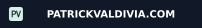

  <h2>Repository Contribution Activity</h2>
  <picture>
    <source media="(prefers-color-scheme: dark)" srcset="https://raw.githubusercontent.com/Darthh/Darthh/output/github-contribution-grid-snake-dark.svg" />
    <source media="(prefers-color-scheme: light)" srcset="https://raw.githubusercontent.com/Darthh/Darthh/output/github-contribution-grid-snake.svg" />
    
  </picture>

# Hi, I'm Darthh/Patrick👋

### Building software where AI, markets, and data meet.

 

## About me

- 🤖 Focused on Finance, AI agents, and Quantitative finance algorithms.
- 📈 Building tools for market data, stock analysis, and financial research
- ⚡ Currently sharpening my systems, cloud, and machine-learning skills

## Languages

  

## Frameworks & Libraries

  

## Tools & Platforms

  
  

